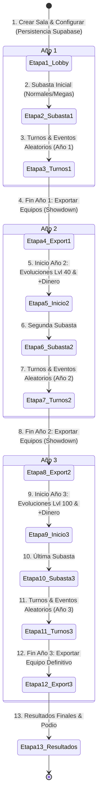

# 🎮 Plan de Implementación: Modo de Juego Subasta Pokémon

Este documento detalla la arquitectura, el diseño técnico y el plan de ejecución para la implementación completa del modo **Subasta Pokémon** en Draft-Prime, basado en el flujo de 13 etapas divididas en **3 Años de competición**.

---

## 📌 Visión General del Modo

El modo **Subasta Pokémon** es una experiencia estratégica multiturno y multi-día donde 2 a 8 jugadores compiten a lo largo de **3 Años**. En cada año participan en una subasta a ciegas/con pistas para armar su equipo, resuelven eventos por turnos, evolucionan sus Pokémon, exportan sus equipos a **Pokémon Showdown** para jugar sus enfrentamientos fuera de la plataforma, y el administrador carga los resultados para determinar al campeón final.

---

## 🔄 Máquina de Estados (13 Etapas en 3 Años)



---

## ⚠️ Puntos de Decisión de Diseño

> [!IMPORTANT]
> **Persistencia Multi-Día en Supabase**
> Para permitir que las partidas duren varios días en la vida real, el estado completo de la partida de Subasta Pokémon debe guardarse dinámicamente en la base de datos (PostgreSQL/Supabase) en cada cambio relevante de etapa o turno, en lugar de residir solo en la memoria RAM del backend.

> [!NOTE]
> **Formato de Exportación a Pokémon Showdown**
> El exportador generará el texto estándar de Showdown:
> ```text
> Pikachu @ Light Ball
> Ability: Static
> Level: 40
> - Thunderbolt
> - Quick Attack
> ```
> Las habilidades, ítems y movimientos iniciales se derivarán de los eventos de turno y datos de PokeAPI.

---

## ❓ Preguntas Abiertas para el Diseño

> [!IMPORTANT]
> 1. **Parámetros Económicos**: ¿Cuál debería ser el presupuesto inicial de `Dinero` por jugador (ej. $10,000) y cuánto dinero extra se añade al inicio del Año 2 y Año 3?
> 2. **Multiplicador de Compra Inmediata**: ¿Cuál es el factor exacto para la compra directa en la subasta? (ej. `Precio_Inicial * 3` o `Precio_Inicial * 4`).
> 3. **Tarifa de Compra Secreta**: ¿Cuánto cuesta en `Dinero` ocultar el Pokémon subastado a los rivales? (ej. un valor fijo como $500 o un % del precio pagado).
> 4. **Duración de Eventos por Turno**: ¿Cuántos turnos de eventos tendrá cada año por defecto (ej. 5 u 8 turnos por año)?

---

## 📐 Detalles Técnicos y Propuesta de Arquitectura

### 1. Base de Datos (Supabase / Memory Fallback)
Se añadirá soporte en `backend/database.py` para la tabla `game_sessions`:
- `session_id` (TEXT PRIMARY KEY)
- `mode` (TEXT)
- `current_stage` (INTEGER, 1 a 13)
- `current_year` (INTEGER, 1 a 3)
- `state_data` (JSONB): Almacena saldos de dinero, equipos de jugadores, evento actual de cada turno, subasta activa y resultados de batallas Showdown.

---

### 2. Integración con PokeAPI (`poke_api.py`)
Módulo encargado de interactuar con `https://pokeapi.co/api/v2/`:
- **Categorización por Tiers**:
  - `Normal`: Pokémon base / no legendarios.
  - `Mega`: Formas mega-evolucionadas.
  - `Legendaria`: Sub-legendarios, legendarios y singulares.
- **Carga de Pistas Paginadas por Multiplicador de Precio**:
  - `Multiplicador 1.0x`: Ninguna pista / Incógnito.
  - `Multiplicador 1.5x`: 1ª letra del nombre.
  - `Multiplicador 2.0x`: Región de origen (Kanto, Johto, Hoenn, etc.).
  - `Multiplicador 2.5x`: Habilidad (*Ability*).
  - `Multiplicador 3.0x`: Tipo primario (*Fire*, *Water*, etc.).
  - `Multiplicador 3.5x`: Estadística base más alta (*Atk*, *Spe*, *HP*, etc.).
- **Caché Local**: Los datos de Pokémon procesados se almacenan en disco/memoria en `backend/modes/subasta_pokemon/cache/` para evitar rate limits HTTP.

---

### 3. Mecánica de Subasta en Tiempo Real
- **Rondas de Subasta**: Se sortea un Pokémon por ronda.
- **Puja**: Los jugadores activos pueden pujar en incrementos configurables.
- **Botón Retirarse**: El jugador sale de la puja de esa ronda. La ronda termina cuando queda solo 1 pujador.
- **Compra Inmediata**: Paga `Precio_Inicial * Multiplicador_Buyout` y gana la ronda automáticamente.
- **Opción de Ocultación**: Al ganar, se presenta la opción `[Mostrar a todos]` o `[Pagar tarifa secreta e inventariar oculto]`.

---

### 4. Sistema de Eventos por Turno
Cada turno $i$ del año genera un evento aleatorio de una tabla de eventos configurable:
- **Ejemplos de Eventos**:
  - *Entrenamiento Intensivo*: Incrementa estadísticas base de un Pokémon.
  - *Encuentro con Objeto*: Otorga una mega-piedra, rest, o ítem competitivo.
  - *Batalla Salvaje*: Permite ganar experiencia/nivel.
  - *Intercambio Desafortunado / Afortunado*: Intercambio condicional de ítem o Pokémon.

---

## 🛠️ Cambios Propuestos

### Componente Backend

#### [MODIFY] [database.py](file:///c:/Users/garma/OneDrive/Documentos/GitHub/Draft-Prime/backend/database.py)
- Añadir funciones de persistencia para sesiones de juego: `save_game_state(session_id, state)` y `load_game_state(session_id)`.

#### [NEW] [poke_api.py](file:///c:/Users/garma/OneDrive/Documentos/GitHub/Draft-Prime/backend/modes/subasta_pokemon/poke_api.py)
- Cliente async/sync para consultar PokeAPI, extraer pistas y categorizar Pokémon por Tiers (Normal, Mega, Legendaria).

#### [NEW] [events_data.py](file:///c:/Users/garma/OneDrive/Documentos/GitHub/Draft-Prime/backend/modes/subasta_pokemon/events_data.py)
- Registro y motor de resolución de los eventos aleatorios para los Años 1, 2 y 3.

#### [MODIFY] [handler.py](file:///c:/Users/garma/OneDrive/Documentos/GitHub/Draft-Prime/backend/modes/subasta_pokemon/handler.py)
- Implementación completa de `SubastaPokemonMode` heredando de `BaseGameMode`:
  - Manejo de acciones WebSocket: `bid`, `fold`, `buyout`, `toggle_secret`, `resolve_turn_event`, `admin_submit_match_results`, `next_year_stage`.
  - Evolución automática de Pokémon (Lvl 40 en Año 2, Lvl 100 en Año 3).

---

### Componente Frontend

#### [NEW] [subasta_ui_components.js](file:///c:/Users/garma/OneDrive/Documentos/GitHub/Draft-Prime/frontend/modes/subasta_pokemon/subasta_ui_components.js)
- Componentes visuales para:
  - Panel de Subasta en vivo con cronómetro, historial de pujas, revelado progresivo de pistas y botones de puja/compra directa.
  - Panel de Evento del Turno actual.
  - Modal de Exportación a Showdown y copia en 1-click al portapapeles.
  - Panel de Administración para cargar victorias/derrotas de combates.

#### [MODIFY] [subasta_pokemon.js](file:///c:/Users/garma/OneDrive/Documentos/GitHub/Draft-Prime/frontend/modes/subasta_pokemon/subasta_pokemon.js)
- Integración completa con `BaseGameModeUI` controlando el cambio dinámico entre la Subasta, el Modo Turnos, la Exportación y la Tabla de Posiciones Finales.

#### [MODIFY] [styles.css](file:///c:/Users/garma/OneDrive/Documentos/GitHub/Draft-Prime/frontend/styles.css)
- Estilos para tarjetas de Pokémon, revelado de pistas de subasta, interfaz de pujas y modal de resultados.

---

## 🧪 Plan de Verificación

### Pruebas Automatizadas
- `backend/tests/test_subasta_pokemon.py`:
  - Tests unitarios de cálculo de pistas por multiplicador de precio.
  - Tests de flujo de subasta (puja, retiro de jugadores, compra inmediata y opción de ocultación).
  - Tests de evoluciones automáticas al cambiar de año.
  - Tests de exportación de formato Showdown.

### Verificación Manual
1. Crear una sala con 2 o más jugadores y seleccionar el modo **Subasta Pokémon**.
2. Simular la subasta del Año 1 verificando que las pistas se revelen progresivamente a medida que sube la puja.
3. Probar la opción de compra secreta y verificar que los rivales vean la carta como "Pokémon Oculto".
4. Avanzar los turnos de eventos del Año 1 y validar el botón de exportación a Showdown.
5. Iniciar el Año 2, corroborar la inyección de dinero adicional y la evolución de los Pokémon que cumplan el nivel.
6. Cargar resultados ficticios como Admin y verificar el cálculo del tablero de posiciones al final del Año 3.
